<p align="center">
  
</p>

# 🎨 Awesome Brand Style Guide & Design System

<p align="center">
  <a href="https://github.com/ishandutta2007/Awesome-Awesome-Awesome"></a>
  <a href="https://discord.gg/jc4xtF58Ve"></a>
  <a href="https://github.com/ishandutta2007/Awesome-Awesome-Awesome"></a>
  <a href="https://github.com/ishandutta2007/Awesome-Brand-Style-Guide-Design-System/stargazers"></a>
  <a href="https://github.com/ishandutta2007/Awesome-Brand-Style-Guide-Design-System/network/members"></a>
  <a href="https://github.com/ishandutta2007/Awesome-Brand-Style-Guide-Design-System/blob/main/LICENSE"></a>
  <a href="https://github.com/ishandutta2007"></a>
</p>

> 🌟 A curated collection of the best **Brand Style Guide Tools**, **Design System Platforms**, **Design Token Management Solutions**, and **Open-Source Resources** for DesignOps, Brand Managers, and Frontend Engineers.

Centralize brand identity assets, document UI/UX design decisions, sync design tokens across Figma and production codebases, and maintain consistent brand governance across digital products.

---

## 📑 Table of Contents

- [🔍 Overview](#-overview)
- [📈 Sector Overview & Market Dynamics](#-sector-overview--market-dynamics)
- [🏢 SaaS & Hosted Brand & Design System Platforms](#-saas--hosted-brand--design-system-platforms)
- [💻 Open-Source Design Systems & Tooling](#-open-source-design-systems--tooling)
  - [📦 Enterprise & Production Design Systems](#-enterprise--production-design-systems)
  - [💎 Design Token Tooling & Specifications](#-design-token-tooling--specifications)
  - [📝 Brand Guidelines Templates & Playgrounds](#-brand-guidelines-templates--playgrounds)
- [🏗️ Recommended Stack & Architecture](#️-recommended-stack--architecture)
- [🤝 How to Contribute](#-how-to-contribute)
- [💖 Support](#-support)
- [⭐ Star History](#-star-history)
- [📜 Disclaimer](#-disclaimer)

---

## 🔍 Overview

A modern **brand style guide** and **design system** ecosystem connects design intent with engineering implementation. This list covers:

- 🗄️ **Digital Asset Management (DAM) & Brand Portals:** Centralized hubs for official logo kits, color palettes, typography scales, and brand governance guidelines.
- 📐 **Design System Documentation Platforms:** Integrations linking Figma, Storybook, and code repositories into a single source of truth.
- ⚡ **Design Token Automation:** Tooling to transform W3C Design Tokens Community Group (DTCG) formats and token trees into CSS, SCSS, iOS, and Android variables.

---

## 📈 Sector Overview & Market Dynamics

The global Digital Asset Management (DAM) and Brand Management market is estimated at **$6.2B – $7.5B in 2025–2026**, growing at a **~15%–18% CAGR** toward **$14B+ by 2031**. The ecosystem is **moderately fragmented**: while enterprise creative giants (like Adobe) anchor Fortune 500 DAM suites, the market remains non-monopolistic with high competitive dispersion across independent SaaS brand portals, specialized token distribution startups, and open-source tooling, leading to gradual M&A consolidation rather than a single winner-take-all outcome.

---

## 🏢 SaaS & Hosted Brand & Design System Platforms

*The table below is sorted descending by Company Size (Revenue / Valuation).*

| Platform | Category | Primary Focus & Key Features | Pricing (Starting Tier) | Free Tier / Trial Limits | Company Size (Revenue / Valuation) |
| :--- | :--- | :--- | :--- | :--- | :--- |
| **[Zoho Style](https://www.zoho.com/branding/)** | Brand Guidelines Portal | Official brand governance portal providing partner branding kit, logo usage rules, color codes, and clear-space compliance. | Free public reference / Zoho ecosystem plans start at $14/user/month (Standard CRM) | **Free forever:** Public guidelines and partner kits free to download anytime with zero expiration. | **$12B - $12.5B valuation** (~$1.4B ARR, bootstrapped conglomerate) |
| **[Frontify](https://www.frontify.com/)** | Enterprise Brand Management & DAM | All-in-one brand management platform combining DAM, digital style guides, and creative collaboration with a Brand SDK, GraphQL API, and AI brand assistant. | Starts at **$29/user/month** (Starter tier billed annually) | **14-day free trial:** Full platform feature access, up to 5 test seats, no credit card required. | **$1.7B valuation** (~$60M ARR, $81M total funding) |
| **[Bynder](https://www.bynder.com/)** | Enterprise DAM & Brand Portal | Enterprise DAM and brand portal with AI-powered search, automated asset tagging, approval workflows, CDN transformation, and 150+ ecosystem integrations. | Starts at **$450/month** (custom entry tier billed annually) | **No free tier:** Evaluation strictly via guided 1-on-1 enterprise sales demo and scoped trial sandbox. | **$1.1B valuation** (~$100M+ ARR, acquired by THL Partners) |
| **[Brandfolder](https://brandfolder.com/)** | Enterprise DAM & Brand Portal | DAM platform with AI-driven discovery, Brand Intelligence analytics, and Smart CDN delivery for rapid organization and brand consistency. | Starts at **$1,600/month** (Premium base tier billed annually) | **No free tier:** Product evaluation available only via guided sales demonstration or custom proof-of-concept trial. | **$155M acquisition valuation** (acquired by Smartsheet / Blackstone) |
| **[Supernova.io](https://www.supernova.io/)** | Design System Platform | End-to-end design system platform uniting Figma, Storybook, and code repositories with automated code generation, scoped MCP servers, and adoption analytics. | Starts at **$29/editor/month** (Team tier billed annually) | **Free forever tier:** Up to 3 editors, 20 documentation pages, 1 MCP server, 1,000 credits/mo, public docs only. | **~$35M - $50M valuation** (~$5M ARR, $14M total funding raised) |
| **[Zeroheight](https://zeroheight.com/)** | Design System Documentation | Single source of truth connecting Figma, Storybook, and code. Features no-code editing, AI drafting, versioned styleguide releases, and MCP-ready documentation. | Starts at **$49/month** (Starter tier billed annually) | **Free forever tier:** 1 styleguide, 1 editor (owner), 1 token set, 500 MCP calls/month, zeroheight badge required. | **~$25M - $35M valuation** (~$4M ARR, $10.8M total funding raised) |
| **[Specify](https://specifyapp.com/)** | Design Token Engine | Design token management platform based on the Specify Design Token Format (SDTF). CLI and SDK sync tokens between Figma, Token Studio, and GitHub repos. | Starts at **$69/month** (Essentials tier billed annually) | **14-day free trial:** Full access to Pro/Team token sync and automated destination workflows. | **Seed-stage (~$8M - $12M valuation)** (~$1M ARR, backed by 360 Capital) |
| **[Standards](https://standards.site/)** | Living Design System Platform | Living brand platform showcasing published design systems (Cash App, Mailchimp) with typography scales, motion guidelines, layout systems, and version evolution. | Starts at **$40/month** (Pro plan with 2 seats included) | **Free trial available:** Free interactive sandbox editor allowing full styleguide building prior to publishing. | **Early-stage boutique (~$3M - $6M valuation)** (privately held design studio startup) |
| **[Brandpad](https://brandpad.io/)** | Brand Identity Portal | Dedicated brand system platform producing bespoke, URL-accessible identity guidelines with direct vector downloads and client access control. | Starts at **$50/month** (Brand plan for 2 live brands) | **21-day free trial (3 weeks):** Unlimited guideline creation and editing with complete template library access. | **~$2M - $4M valuation** (~$880K ARR, boutique Norwegian startup) |
| **[Corebook](https://www.corebook.io/)** | Interactive Brand Guidelines | Cloud-based brand guideline studio allowing real-time asset downloads, modular layout builders, password/SSO protection, and team permissions. | Starts at **$119/month** (Brand Owner monthly plan; or $1,100 lifetime studio license) | **14-day free trial:** Full functionality with online editing tools; forever-free basic creator view-only access. | **~$1.5M - $3M valuation** (<$1M ARR, micro-VC & bootstrapped) |

---

## 💻 Open-Source Design Systems & Tooling

*The repositories below are equipped with star badges linked directly to their stargazers page and sorted descending by star count.*

### 📦 Enterprise & Production Design Systems

- **[shadcn/ui](https://github.com/shadcn-ui/ui)** [](https://github.com/shadcn-ui/ui/stargazers)  
  Beautifully designed, accessible components and design token primitives that you can copy and paste into your apps. Built with Radix UI and Tailwind CSS.

- **[Ant Design](https://github.com/ant-design/ant-design)** [](https://github.com/ant-design/ant-design/stargazers)  
  An enterprise-class UI design language and React UI library with a comprehensive design guideline, design token design specification, and global theme customization.

- **[awesome-design-systems](https://github.com/alexpate/awesome-design-systems)** [](https://github.com/alexpate/awesome-design-systems/stargazers)  
  A world-renowned community-curated collection of publicly available design systems, style guides, pattern libraries, and design ops resources.

- **[Microsoft Fluent UI](https://github.com/microsoft/fluentui)** [](https://github.com/microsoft/fluentui/stargazers)  
  Microsoft's cross-platform design system and component collection providing seamless brand style cohesion across Windows, Web, iOS, and Android applications.

- **[Adobe React Spectrum](https://github.com/adobe/react-spectrum)** [](https://github.com/adobe/react-spectrum/stargazers)  
  Adobe's collection of libraries and tools providing the foundation for Adobe's design system, including accessible UI components, ARIA hooks, and adaptive styling.

- **[IBM Carbon Design System](https://github.com/carbon-design-system/carbon)** [](https://github.com/carbon-design-system/carbon/stargazers)  
  IBM’s open-source design system for products and digital experiences, featuring IBM Design Language guidelines, web components, and token variables.

- **[GitHub Primer React](https://github.com/primer/react)** [](https://github.com/primer/react/stargazers)  
  React implementation of GitHub's Primer Design System, powering GitHub.com's user interface with comprehensive token foundations and accessibility primitives.

- **[Salesforce Lightning Design System](https://github.com/salesforce-ux/design-system)** [](https://github.com/salesforce-ux/design-system/stargazers)  
  The world-class design system framework and design tokens used by Salesforce to build unified enterprise user interfaces.

- **[Storybook Design System](https://github.com/storybookjs/design-system)** [](https://github.com/storybookjs/design-system/stargazers)  
  Production design system codifying Storybook's UI components into a central repository; built with React, Storybook, and Emotion, and distributed via npm.

- **[Appian Aurora Design System](https://github.com/appian-design/aurora)** [](https://github.com/appian-design/aurora/stargazers)  
  Centralized design system documentation platform built with MkDocs, exposing design patterns, accessibility rules, and brand guidelines directly via MCP servers.

### 💎 Design Token Tooling & Specifications

- **[Style Dictionary](https://github.com/amzn/style-dictionary)** [](https://github.com/amzn/style-dictionary/stargazers)  
  Amazon's open-source build system for design tokens. Transforms unified token files (JSON/YAML) into cross-platform variables for CSS, SCSS, JavaScript, iOS (Swift), and Android.

- **[Tokens Studio for Figma](https://github.com/tokens-studio/figma-plugin)** [](https://github.com/tokens-studio/figma-plugin/stargazers)  
  The leading Figma plugin and engine to define, manipulate, and sync design tokens with GitHub repositories using the standardized DTCG format.

- **[W3C Design Tokens Community Group (DTCG)](https://tr.designtokens.org/format/)**  
  The official vendor-neutral specification establishing a standardized data structure for design tokens across design software (Figma, Sketch) and code build tools.

- **[forge-brand](https://github.com/nino-chavez/forge-brand)** [](https://github.com/nino-chavez/forge-brand/stargazers)  
  CLI-first agency toolkit for generating brand kits, style guides, and media assets using JSON presets with Satori/Resvg SVG rendering.

### 📝 Brand Guidelines Templates & Playgrounds

- **[design-system-playground](https://github.com/motaterry/design-system-playground)** [](https://github.com/motaterry/design-system-playground/stargazers)  
  Reference implementation demonstrating design system documentation structure with design tokens, guidelines, and consistency audit scoring.

- **[Brand Guidelines Markdown Template](https://github.com/aiskillstore/marketplace)**  
  Modular markdown template specifying color palettes, typography hierarchies, logo clear space, voice & tone, and asset rules.

- **[Brand Style Guide Template](https://github.com/rampstackco/claude-skills)**  
  Structured markdown guidelines template covering brand story, visual identity tokens, logo safe zones, and component usage.

---

## 🏗️ Recommended Stack & Architecture

For organizations building a modern, vendor-neutral brand & design system architecture:

```
┌────────────────────────┐      ┌─────────────────────────┐
│  Design Tools (Figma)  │ ───► │ Token Studio / Specify  │
└────────────────────────┘      └────────────┬────────────┘
                                             │ (DTCG JSON)
                                             ▼
┌────────────────────────┐      ┌─────────────────────────┐
│ Web / iOS / Android UI │ ◄─── │    Style Dictionary     │
└────────────────────────┘      └─────────────────────────┘
                                             ▲
┌────────────────────────┐                   │
│ Storybook / MkDocs     │ ──────────────────┘
│ (Living Documentation) │
└────────────────────────┘
```

1. **Tokens:** Define design decisions in Figma / Tokens Studio using the W3C DTCG specification.
2. **Build:** Use Amazon Style Dictionary to compile tokens into platform-native targets (CSS variables, SCSS maps, Swift, Kotlin).
3. **Documentation:** Host component libraries and guidelines with Storybook or MkDocs, augmented with MCP support for AI coding assistants.

---

## 🤝 How to Contribute

Contributions are very welcome! To suggest additions or updates:

1. 🍴 Fork the repository.
2. 📝 Add or update entries in `README.md` following the table or list schema.
3. 🚀 Submit a pull request with a concise summary of the addition.

---

## 💖 Support

If you find this repository helpful, please consider supporting the project:

- ⭐ **Star this repository** on GitHub to help others discover it.
- 🍴 **Fork and contribute** your favorite brand guides and design system resources.
- 📢 **Share** this list with colleagues, designers, and frontend engineers.
- ☕ **Buy me a coffee / Sponsor**: If you'd like to support ongoing maintenance and new curated resources, check out the [GitHub Sponsor Dashboard](https://github.com/sponsors/ishandutta2007).

Thank you for being part of the open-source and design community! 🙏✨

---

## ⭐ Star History

[](https://www.star-history.com/#ishandutta2007/Awesome-Brand-Style-Guide-Design-System&type=date&legend=top-left)

---

## 📜 Disclaimer

This repository is an independent, community-curated list and is not affiliated with any of the listed companies or tools. All trademarks, logos, and brand names are the property of their respective owners.
